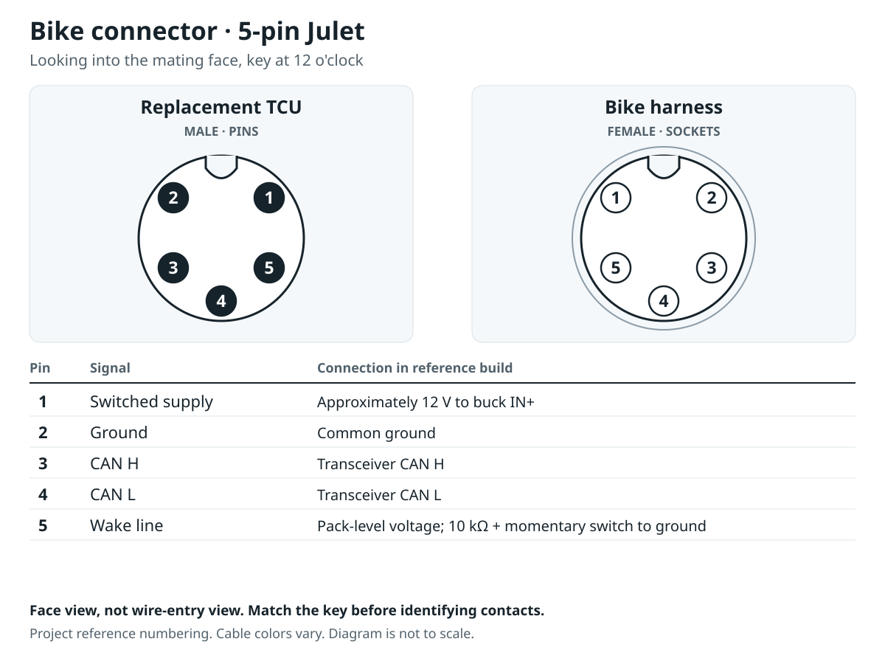
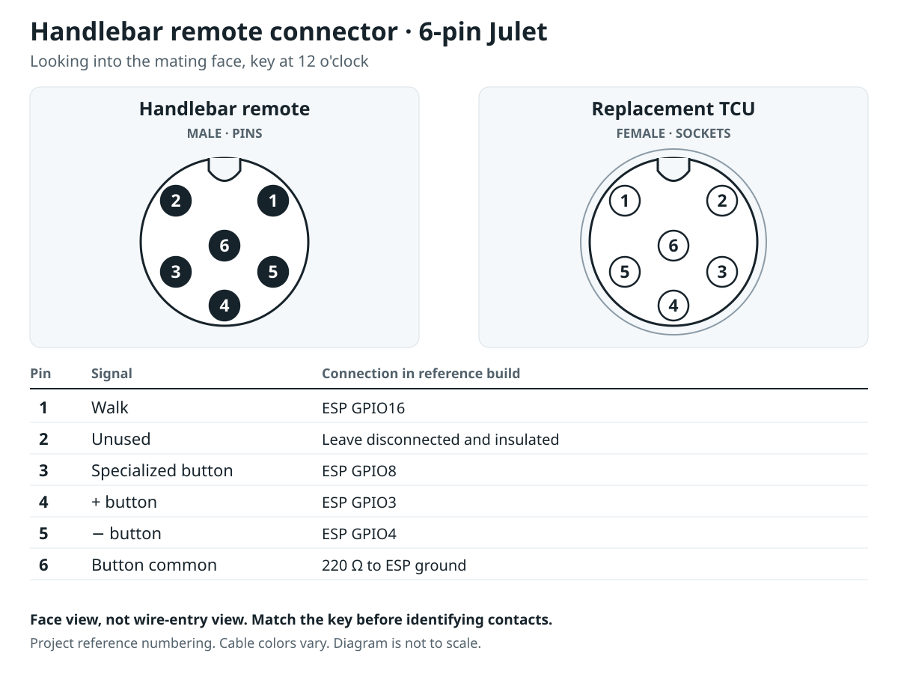
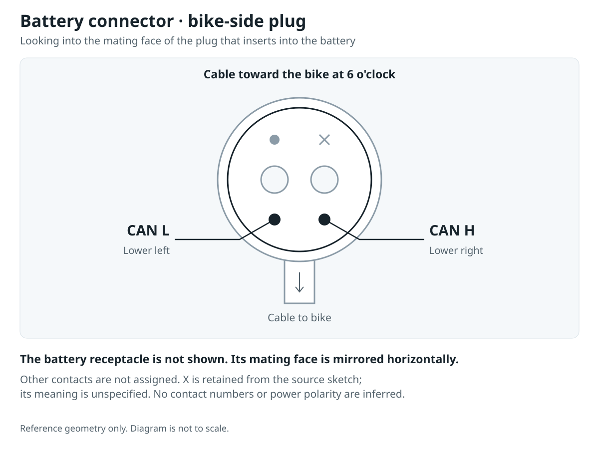

# Connector pinouts

**Julet views: looking into the mating face, with the key at 12 o’clock.** The separate battery plug is shown cable-down. These are not wire-entry views.

Pin numbers are project references transcribed from the builder’s keyed-face drawings. They are not a claimed manufacturer numbering standard. Signal assignments combine those drawings with the tested reference harness. Verify your own connector and cable continuity; pigtail colors are not standardized.

The Signal column describes the harness. ESP GPIO numbers are choices made for this reference build, not requirements of the bike protocol. Match each contact to its wire using continuity; ignore insulation colors.

## Bike connector



| Pin | Signal | Connection in reference build |
|---|---|---|
| 1 | Switched supply | Approximately 12 V to buck IN+ |
| 2 | Ground | Common ground |
| 3 | CAN H | Transceiver CAN H |
| 4 | CAN L | Transceiver CAN L |
| 5 | Wake line | Pack-level voltage; 10 kΩ + momentary switch to ground |

## Handlebar remote connector



| Pin | Signal | Connection in reference build |
|---|---|---|
| 1 | Walk | ESP GPIO16 |
| 2 | Unused | Leave disconnected and insulated |
| 3 | Specialized button | ESP GPIO8 |
| 4 | + button | ESP GPIO3 |
| 5 | − button | ESP GPIO4 |
| 6 | Button common | 220 Ω to ESP ground |

The wake line is not an ESP input. See the [hardware guide](README.md) for power, termination, the wake switch and remote pull-ups.

## Battery connector



This is the **plug on the bike that inserts into the battery**, viewed from its mating face with the cable downward. CAN L is the lower-left contact and CAN H is the lower-right. The battery itself is not drawn; its mating face would be mirrored horizontally.

Other contacts are not assigned. X is retained from the source sketch; its meaning is unspecified. No contact numbers or power polarity are inferred.

## Regenerate

Edit `hardware/connectors.json`, then run from the repository root:

```sh
python3 tools/generate_connector_diagrams.py
```

This writes the SVGs and this page using only the Python standard library. The original reference photos remain outside the public repository.
